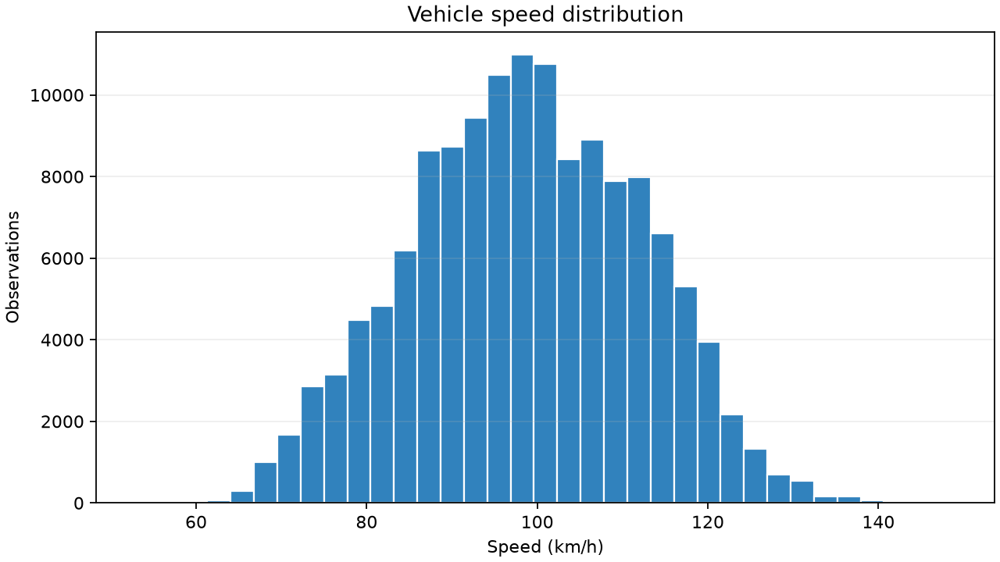
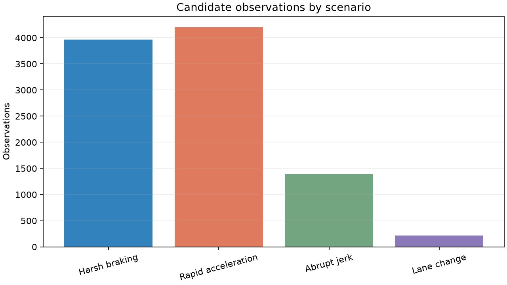

# 🚗 Vehicle Trajectory Analytics

### From highway motion data to clear driving insights

A compact Python project for exploring real-world vehicle trajectories, engineering motion features, and surfacing **candidate driving scenarios** such as harsh braking, rapid acceleration, abrupt jerk, and lane changes.


---

## At a glance

| | |
|---|---|
| **Dataset** | FHWA TGSIM I-294 Level 2 trajectories |
| **Analysis** | Data exploration, feature engineering, scenario detection |
| **Tools** | Python · pandas · NumPy · Jupyter · Matplotlib · Seaborn |

## What this project does

- Explores vehicle movement, speed, acceleration, and lane data.
- Converts speed to km/h and derives jerk and absolute acceleration.
- Flags candidate harsh-braking, rapid-acceleration, abrupt-jerk, and lane-change observations using transparent rules.
- Groups consecutive flagged observations into event episodes for easier review.
- Includes unit tests for preprocessing, feature engineering, and scenario detection.

**These are screening candidates, not validated safety events.** Thresholds are heuristics; flags need context and review before drawing conclusions about driver behavior or risk.

## Project workflow

```text
Raw trajectory CSV
        ↓
01 · Explore & clean
        ↓
02 · Engineer motion features
        ↓
03 · Detect & summarize scenarios
        ↓
Processed CSV outputs → scenario summaries and visual analysis
```

## Repository layout

```text
├── data/                 # Local raw and processed CSVs (git-ignored)
├── notebooks/
│   ├── 01_data_exploration.ipynb
│   ├── 02_feature_engineering.ipynb
│   └── 03_scenario_detection.ipynb
├── src/python/           # Reusable loading, preprocessing, features, detection
├── tests/                # Unit tests
├── requirements.txt
└── README.md
```

## Get started

### 1. Set up Python

Python 3.10 or newer is recommended.

```bash
python -m venv .venv
```

Activate the environment, then install dependencies:

```bash
# Windows PowerShell
.venv\Scripts\Activate.ps1

# macOS / Linux
source .venv/bin/activate

pip install -r requirements.txt
```

### 2. Add the dataset

Download the **TGSIM I-294 L2 Trajectories** CSV from the [official Data.gov dataset page](https://catalog.data.gov/dataset/third-generation-simulation-data-tgsim-i-294-l2-trajectories) and place it at:

```text
data/raw/TGSIM_I294_L2_Trajectories.csv
```

The `data/` directory is excluded from Git, so the source data and generated outputs stay local. The notebooks expect the folder structure above.

### 3. Run the notebooks in order

Start Jupyter from the repository root:

```bash
jupyter notebook
```

Then run:

1. `notebooks/01_data_exploration.ipynb` — inspect and clean the source data.
2. `notebooks/02_feature_engineering.ipynb` — add speed, jerk, and acceleration features.
3. `notebooks/03_scenario_detection.ipynb` — flag candidate observations and summarize event episodes.

The notebooks write intermediate and final CSVs under `data/processed/`.

## Scenario rules

The current defaults flag acceleration at or below **−3 m/s²** as harsh-braking candidates and at or above **+3 m/s²** as rapid-acceleration candidates. Abrupt jerk uses an absolute threshold; lane changes are detected from lane-label transitions with a short time-gap check. See `src/python/scenario_detection.py` and the scenario notebook for the parameters and assumptions.

These rules are intended to make data review repeatable. They do not establish that an event was dangerous, intentional, or caused by a particular driver.

## Tests

Run the unit tests from the repository root:

```bash
pytest
```

## Visualizations

These plots are generated from the local processed trajectory data and candidate flags. Run the notebooks in order to reproduce the analysis.





## Dataset & attribution

The project uses the **Third Generation Simulation Data (TGSIM) – I-294 L2 Trajectories** dataset published by the U.S. Federal Highway Administration. The trajectories cover vehicles on I-294 near Chicago, Illinois.

- [Official Data.gov listing](https://catalog.data.gov/dataset/third-generation-simulation-data-tgsim-i-294-l2-trajectories)
- [U.S. DOT data portal](https://data.transportation.gov/d/tpsq-zrwa)

**Citation:** U.S. Department of Transportation Federal Highway Administration. (2024). *Third Generation Simulation Data (TGSIM) I-294 L2 Trajectories*. ITS DataHub. [https://doi.org/10.21949/1404224](https://doi.org/10.21949/1404224)

See [LICENSE](LICENSE) for the license covering this project. Check the dataset source for its own data-use terms.

---

<p align="center"><i>Exploring how vehicles move, one trajectory at a time.</i></p>
